<div align="center">



<br/>

<a href="https://github.com/Tomazzyy"></a>


</div>

<br/>



## ⚡ `PERFIL_DO_USUARIO.sys`

<table width="100%">
<tr>
<td width="50%" valign="top">

```yaml
foco:
  - Front-end
  - Back-end
  - Performance
  - Clean Code
  - UI/UX
```

</td>
<td width="50%" valign="top">

```yaml
mentalidade:
  - Disciplina
  - Constância
  - Criatividade
  - Evolução
hobbies: [Jogos, Projetos pessoais, Tecnologia]
```

</td>
</tr>
</table>

## 🥷 `NIVEL_DE_PODER.exe`



## 🛠️ `TECH_STACK.dll`

<div align="center">


</div>

## 🚀 `PROJETOS_ATIVOS.db`

<div align="center">

<a href="https://github.com/Tomazzyy/OPUS-PDV"></a>
<a href="https://github.com/Tomazzyy/FURG-TERROR-EXE"></a>
<a href="https://github.com/Tomazzyy/Tech-Financas"></a>
<a href="https://github.com/Tomazzyy/StudyOrganizer"></a>

</div>

## 📊 `GITHUB_ANALYTICS.exe`



## 🎓 `FORMACAO.log`

```diff
+ [CONCLUÍDO] Técnico em Desenvolvimento de Sistemas · Unicesumar
! [CURSANDO]  Ciência da Computação · Estácio
! [CURSANDO]  Licenciatura em Matemática · FURG
```

## 🌐 `CONTATO.link`

<div align="center">

<a href="mailto:viniciustomaz654@gmail.com"></a>
<a href="https://www.linkedin.com/in/vin%C3%ADcius-tomaz-oliveira-vit%C3%B3ria-03972126a/"></a>
<a href="https://github.com/Tomazzyy"></a>

<br/><br/>


</div>
